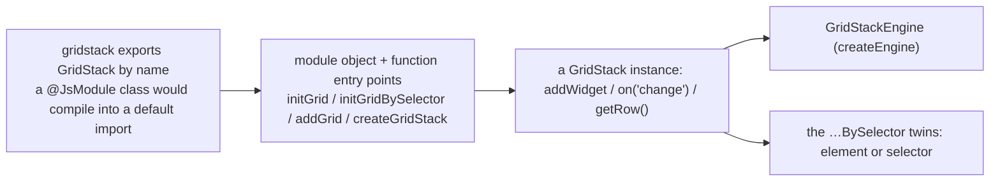

# API overview

## Package layout

| Package | Contents |
| --- | --- |
| `io.github.shijianjs.ktjs.gridstack` | `GridStack`, `GridStackModule`, `initGrid`, `initGridBySelector`, `initAllGrids`, `addGrid`, `createGridStack` |
| `…gridstack.core` | `GridStackOptions`, `gridStackOptions`, `GridStackPartialOptions`, `Responsive`, `Breakpoint`, `breakpoint`, `DDDragOpt`, `DDResizeOpt`, `DDRemoveOpt`, `PrintOptions` |
| `…gridstack.core` | `GridStackWidget`, `gridStackWidget`, `GridStackNode`, `GridStackPosition`, `GridStackMoveOpts`, `GridItemHTMLElement`, `SavedLayout`, `AddRemoveOption`, `GridStackEvents`, `GridStackModes`, `ColumnOptionsValues` |
| `…gridstack.core` | `GridStackEngine`, `createEngine`, `NumberOrString`, `numberOrString`, `ColumnCount`, `columnCount`, `autoColumnCount`, `Position`, `Size`, `Rect`, `DDUIData`, `CellPosition`, `MousePosition` |

## Conventions this wrapper follows

- `gridstack` exports its classes by name (`export { GridStack }`), and a Kotlin `@JsModule` **class**
  compiles into a *default* import, which webpack rejects (`export 'default' … was not found`). The
  wrapper binds the module as an external object and reaches the class through it.
- `HTMLElement` is an `external class` in kotlin-browser, and a Kotlin interface cannot extend a class;
  `GridItemHTMLElement` therefore carries only `gridstackNode`, plus `asElement()` to get the DOM
  surface back.
- Upstream takes “an element *or* a selector” in a dozen methods. Kotlin cannot overload on that
  union implicitly, so each such method has a `…BySelector` twin (`makeWidgetBySelector`,
  `removeWidgetBySelector`, `updateBySelector`, `movableBySelector`, `resizableBySelector`).
- Option and widget objects are built with `unsafeJso` builders: what you do not set stays absent,
  and the library reads “absent” differently from `null` (option merging, `sizeToContent`, `autoPosition`).

## What is deliberately typed loosely

| Member | Kotlin type | Why |
| --- | --- | --- |
| `acceptWidgets` | `JsAny?` | upstream is `boolean \| string \| (element) => boolean` |
| `removable` | `JsAny?` | upstream is `boolean \| string` |
| `alwaysShowResizeHandle` | `JsAny?` | upstream is `true \| false \| "mobile"` |
| `rtl` | `JsAny?` | upstream is `boolean \| "auto"` |
| `engineClass` | `JsAny?` | upstream is `typeof GridStackEngine` |
| `helper` (`DDDragOpt`) | `JsAny?` | upstream is `"clone" \| (el) => el` |
| `sizeToContent` (`GridStackWidget`) | `JsAny?` | upstream is `boolean \| number` |
| `findEmptyPosition`'s `after` | `JsAny?` | upstream is `GridStackNode \| number` |

Every row is a genuine union or class reference in the upstream `.d.ts`, and each is recorded in
`docs/development/technical-decisions.md`.
