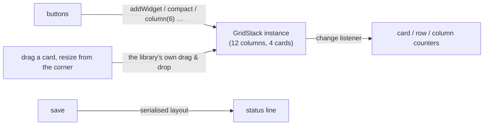

# Demo

The demo lives at [https://shijianjs.github.io/ktjs-gridstack/demo/](https://shijianjs.github.io/ktjs-gridstack/demo/).

The demo mounts a real dashboard: four cards laid out across 12 columns, draggable by their
content area and resizable from the corner (both are the library's own drag and drop). The buttons
call `addWidget`, `compact`, `column(6)`, `column(12)` and `save` through the wrapper, a `change`
listener keeps the card/row/column counters honest while you drag, and the language switch rewrites
every label on the page.

The language button in the page header switches between English and Simplified Chinese: every
visible string changes, not just the title.

The API reference is at [https://shijianjs.github.io/ktjs-gridstack/api/](https://shijianjs.github.io/ktjs-gridstack/api/), generated by Dokka from the published modules.
