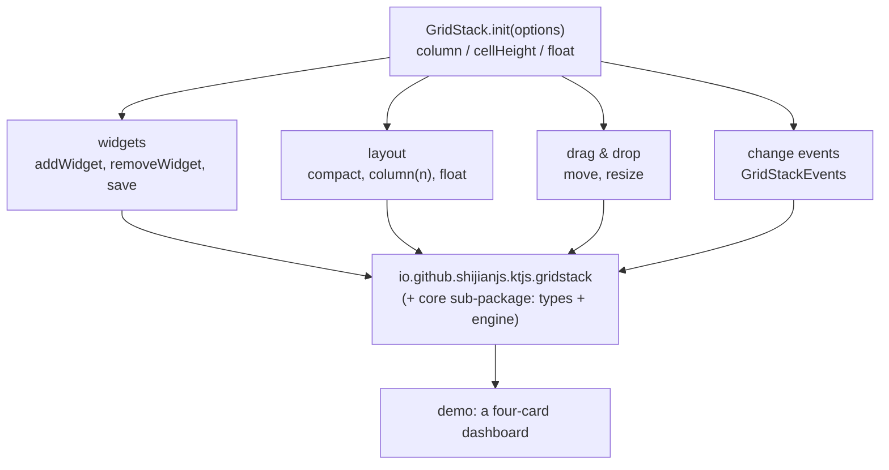

# Introduction

`ktjs-gridstack` is a Kotlin/JS wrapper for [`gridstack`](https://github.com/gridstack/gridstack.js) from [GridStack](https://github.com/gridstack/gridstack.js) 14.1.0: every type and member of
the upstream `.d.ts` files becomes an `external` declaration the compiler checks, with no
`dynamic` fallback.

The wrapper covers the `gridstack` 14 package: the `GridStack` class with all its layout methods (`addWidget`, `load`, `save`, `compact`, `column`, `mode`, `update`, `removeWidget`, the enable/disable family, the subscript helpers), the static `init` / `initAll` / `addGrid` entry points, the engine (`GridStackEngine`), the whole options surface (`GridStackOptions` with ~40 fields, `Responsive` + `Breakpoint`, `DDDragOpt` / `DDResizeOpt` / `DDRemoveOpt`), the widget types (`GridStackWidget`, `GridStackNode`), the geometry types (`Position`, `Size`, `Rect`, `CellPosition`, `MousePosition`) and the event names.

## What is wrapped

| Module | Gradle artifact | Upstream |
| --- | --- | --- |
| `ktjs-gridstack` | `io.github.shijianjs:ktjs-gridstack` | `gridstack` 14.1.0 |

One npm package, one Gradle module, one Kotlin package (`io.github.shijianjs.ktjs.gridstack`) with a `core` sub-package for the types and the engine.

The engine draws the grid and does the dragging; the wrapper decides which layout calls exist and how
a widget's options are typed.

## License

The wrapper itself is MIT. The upstream `gridstack` license differs from it — read the
[license notes](guide/license.md) before shipping it commercially.

## Where to go next

- [Getting started](guide/getting-started.md) — add the dependency, make the first call, run the build.
- [API overview](guide/api-overview.md) — package layout, type mapping conventions, common patterns.
- [Demo](guide/demo.md) — see it running in the browser.
