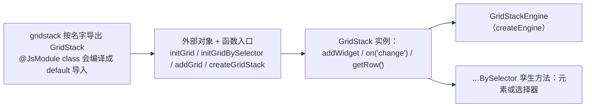

# API 概览

## 包结构

| 包 | 内容 |
| --- | --- |
| `io.github.shijianjs.ktjs.gridstack` | `GridStack`、`GridStackModule`、`initGrid`、`initGridBySelector`、`initAllGrids`、`addGrid`、`createGridStack` |
| `…gridstack.core` | `GridStackOptions`、`gridStackOptions`、`GridStackPartialOptions`、`Responsive`、`Breakpoint`、`breakpoint`、`DDDragOpt`、`DDResizeOpt`、`DDRemoveOpt`、`PrintOptions` |
| `…gridstack.core` | `GridStackWidget`、`gridStackWidget`、`GridStackNode`、`GridStackPosition`、`GridStackMoveOpts`、`GridItemHTMLElement`、`SavedLayout`、`AddRemoveOption`、`GridStackEvents`、`GridStackModes`、`ColumnOptionsValues` |
| `…gridstack.core` | `GridStackEngine`、`createEngine`、`NumberOrString`、`numberOrString`、`ColumnCount`、`columnCount`、`autoColumnCount`、`Position`、`Size`、`Rect`、`DDUIData`、`CellPosition`、`MousePosition` |

## 本 wrapper 的约定

- `gridstack` 按名字导出类（`export { GridStack }`），而 Kotlin 的 `@JsModule` **类**会编译成*默认*
  导入，webpack 会报 `export 'default' … was not found`。wrapper 把模块绑定成 external object，再经它
  取类。
- kotlin-browser 里 `HTMLElement` 是 `external class`，Kotlin 接口不能继承类；因此
  `GridItemHTMLElement` 只承载 `gridstackNode`，另用 `asElement()` 取回 DOM 表面。
- 上游有十几个方法接受「元素 *或* 选择器」。Kotlin 无法隐式地按联合重载，因此每个这样的方法都有
  `…BySelector` 孪生（`makeWidgetBySelector`、`removeWidgetBySelector`、`updateBySelector`、
  `movableBySelector`、`resizableBySelector`）。
- 选项与控件对象用 `unsafeJso` 构造器：没设置的字段保持缺失 —— 库对「缺失」与 `null` 的读法不同
  （选项合并、`sizeToContent`、`autoPosition`）。

## 有意放宽的类型

| 成员 | Kotlin 类型 | 原因 |
| --- | --- | --- |
| `acceptWidgets` | `JsAny?` | 上游是 `boolean \| string \| (element) => boolean` |
| `removable` | `JsAny?` | 上游是 `boolean \| string` |
| `alwaysShowResizeHandle` | `JsAny?` | 上游是 `true \| false \| "mobile"` |
| `rtl` | `JsAny?` | 上游是 `boolean \| "auto"` |
| `engineClass` | `JsAny?` | 上游是 `typeof GridStackEngine` |
| `helper`（`DDDragOpt`） | `JsAny?` | 上游是 `"clone" \| (el) => el` |
| `sizeToContent`（`GridStackWidget`） | `JsAny?` | 上游是 `boolean \| number` |
| `findEmptyPosition` 的 `after` | `JsAny?` | 上游是 `GridStackNode \| number` |

每一行都是上游 `.d.ts` 里真实存在的联合或类引用，均记在 `docs/development/technical-decisions.md`。
