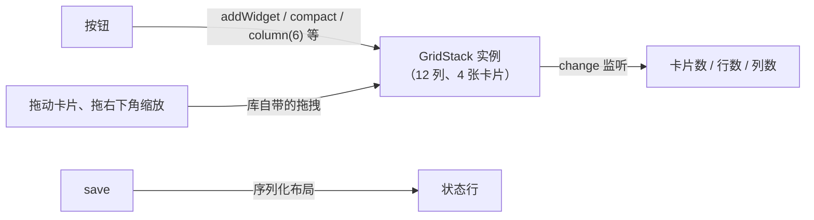

# 演示页

演示页：[https://shijianjs.github.io/ktjs-gridstack/demo/](https://shijianjs.github.io/ktjs-gridstack/demo/)

演示页挂了一个真实仪表盘：四张卡片排在 12 列上，拖内容区即可移动、拖右下角即可缩放（都是库自带的
拖拽实现）。按钮通过 wrapper 调用 `addWidget`、`compact`、`column(6)`、`column(12)` 与 `save`，
`change` 监听在拖动时同步更新卡片数/行数/列数，语言开关会改写页面上每一个标签。

页面右上角的语言按钮在英文与简体中文之间切换，切换的是页面上全部可见文案（不只是页面标题）。

API 文档在 [https://shijianjs.github.io/ktjs-gridstack/api/](https://shijianjs.github.io/ktjs-gridstack/api/)，由 Dokka 从已发布模块生成。
